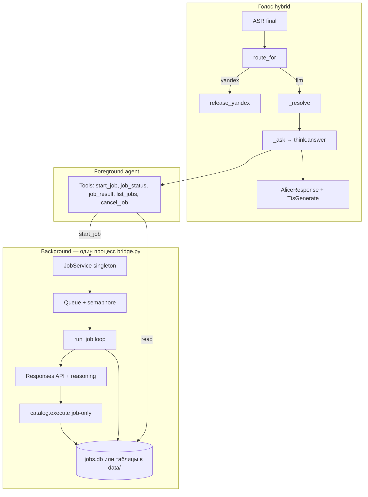

# Agent pipeline (фоновые задачи на колонке)

Реализовано в `agent/pipeline/` (по умолчанию **выключено**: `BRIDGE_PIPELINE=0`). Долгие исследования и multi-step agent **не блокируют** голосовой ответ; состояние и результаты хранятся в `JOBS_DB_PATH`, отдельно от `Session.history`. Пример env: [bridge.env.example](bridge.env.example).

Проверки:

```bash
python3 deepseek-bridge/bridge.py selftest
cd deepseek-bridge && python3 -m unittest discover -s tests -v
```

Связанный код сегодня:

| Что | Где |
| --- | --- |
| WebSocket, маршрут Yandex vs LLM | `bridge.py` — `Session`, `_resolve`, `_ask`, `route_for` |
| Синхронный tool loop (Chat Completions) | `agent/think.py` — `answer()` |
| HTTP к DeepSeek | `agent/llm.py` — `post_chat()` |
| Схемы tools + dispatch | `agent/catalog.py` — `enabled_specs()`, `execute()` |
| Долговременная память диалогов | `agent/memory/` — **не** job store |
| Эталон Responses API | `pi/jarvis_pi/commands/think.py` — переносить парсинг событий, не копировать Pi tools целиком |

---

## Поток данных



**Принцип:** `_resolve` по-прежнему ждёт только **короткий** ответ foreground-агента. Тяжёлый цикл — в `JobService`, в `threading` или `asyncio.to_thread`, с лимитом параллелизма.

---

## Новые модули (предлагаемая раскладка)

```
deepseek-bridge/agent/
  pipeline/
    __init__.py          # get_job_service()
    config.py            # JOB_* env, лимиты worker
    store.py             # SQLite CRUD + миграции
    models.py            # Job, JobStep, JobStatus enum
    tools.py             # RESPONSES tool specs + execute_job_tool()
    service.py           # очередь, start/cancel, on_complete hooks
    worker.py            # run_job(job_id): Responses loop
    instructions.py      # system prompt только для worker (без голосовых лимитов 500)
  responses_llm.py       # post_responses, parse events (из Pi think.py, без jarvis_pi)
```

Почему **отдельная** БД/таблицы, а не эпизоды памяти:

- эпизоды — сжатые саммари диалога; job хранит **полный отчёт**, шаги tools, статусы;
- worker не должен попадать в `memory.record_exchange` на каждый web_search;
- replay/status — детерминированные SQL-запросы, не FTS по эпизодам.

Файл по умолчанию: `{data_dir}/jobs.db` или таблицы в том же каталоге, что `memory.db` (`MEMORY_DB_PATH` parent + `jobs.db`). Env: `JOBS_DB_PATH`.

---

## Схема SQLite

```sql
CREATE TABLE jobs (
    id TEXT PRIMARY KEY,              -- uuid, короткий alias для голоса optional
    title TEXT NOT NULL,              -- «зарплаты программистов»
    prompt TEXT NOT NULL,             -- исходная формулировка пользователя
    status TEXT NOT NULL DEFAULT 'queued',
        -- queued | running | done | failed | canceled
    parent_id TEXT REFERENCES jobs(id),
    created_at TEXT NOT NULL,
    updated_at TEXT NOT NULL,
    started_at TEXT,
    finished_at TEXT,
    progress_note TEXT,               -- последняя человекочитаемая строка для status
    result_text TEXT,                 -- полный отчёт (может быть >> 500 символов)
    spoken_summary TEXT,              -- что уже готовили для TTS при done (optional)
    error_text TEXT,
    model TEXT,                       -- фактически использованная BRIDGE_JOB_MODEL
    tool_rounds INTEGER DEFAULT 0
);

CREATE INDEX idx_jobs_status ON jobs(status);
CREATE INDEX idx_jobs_updated ON jobs(updated_at DESC);

CREATE TABLE job_steps (
    id INTEGER PRIMARY KEY AUTOINCREMENT,
    job_id TEXT NOT NULL REFERENCES jobs(id),
    step_index INTEGER NOT NULL,
    kind TEXT NOT NULL,               -- tool | note | model
    tool_name TEXT,
    detail TEXT NOT NULL,             -- до ~500 символов, без секретов
    created_at TEXT NOT NULL
);

CREATE INDEX idx_job_steps_job ON job_steps(job_id, step_index);

-- Опционально v2: дочерние задачи уже через parent_id в jobs
```

Поиск «старой задачи про зарплаты»: `title LIKE` + `ORDER BY updated_at` или простой FTS по `(title, prompt)` в v2.

---

## Tools (foreground only)

Добавить в каталог **отдельным списком** `PIPELINE_TOOLS` в `agent/pipeline/tools.py`, подключать в `enabled_specs()` только для foreground **или** всегда, но `execute()` в worker **не** регистрирует `start_job` (чтобы worker не порождал бесконечную рекурсию без лимита).

| Tool | Назначение |
| --- | --- |
| `start_background_job` | `title`, `brief` (инструкция worker), опционально `parent_job_id` → возвращает `job_id`, ставит в очередь |
| `list_background_jobs` | `status?`, `limit?` — последние N |
| `get_background_job_status` | `job_id` или `title_query` |
| `get_background_job_result` | `job_id`, `format`: `summary` \| `full` — full только в tool output модели, не озвучивать целиком |
| `cancel_background_job` | `job_id` |

**Dispatch:** в `catalog._execute()` в конце — делегировать в `execute_pipeline_tool(name, args)` если `name` в pipeline set.

**Worker tool set:** `enabled_specs()` минус `decline`, minus pipeline tools, minus (опционально) `rewrite_self` / `control_home` — через `job_tool_specs()` в `pipeline/worker.py`.

---

## Responses worker (внутренний контур)

1. Загрузить job из store, `status=running`, `progress_note=...`.
2. `input = [{"role":"user","content": job.prompt + "\n\n" + job.brief}]` (или одно поле `worker_brief` в таблице).
3. Цикл как на Pi (`_post_responses` → output items → function calls → `function_call_output`):
   - `instructions` из `pipeline/instructions.py` (многошаговое исследование, cite sources кратко, финал — structured markdown в последнем message).
   - `tools`: `job_tool_specs()`.
   - `reasoning`: `BRIDGE_JOB_REASONING` / effort (см. Pi `_reasoning_body`).
4. После каждого tool: `store.append_step(...)`, обновить `progress_note`.
5. Успех: `result_text`, `spoken_summary` (можно вторым коротким вызовом Completions или обрезка), `status=done`.
6. Ошибка API / лимит раундов: `status=failed`, `error_text`.

**Не** использовать `Session.history` и **не** писать каждый шаг в `memory.record_exchange`.

Перенос кода: `pi/jarvis_pi/commands/think.py` функции примерно `_iter_response_events` … `_post_responses`, `_function_calls_from_output` → `agent/responses_llm.py`. URL/model из `agent/config.py` расширить:

```python
RESPONSES_URL = "https://api.deepseek.com/responses"
# BRIDGE_JOB_MODEL — default deepseek-chat или reasoner
# BRIDGE_JOB_MAX_TOOL_ROUNDS — default 24
# BRIDGE_JOB_STEP_TIMEOUT_SEC — default 120
# BRIDGE_MAX_CONCURRENT_JOBS — default 1
```

Foreground остаётся на `post_chat` + текущие лимиты, пока не решите мигрировать и `answer()`.

---

## Куда врезаться в существующий код

### 1. `bridge.py` — минимально

| Место | Изменение |
| --- | --- |
| `Session.__init__` | Не обязательно держать jobs в session; сервис — процесс-wide singleton. |
| `_ask` (≈630–648) | Перед/после `agent_answer`: опционально `get_job_service().touch()` только для логов; **не** менять контракт `(result, err)`. |
| `handle_client` (≈759) | После `session = Session()`: один раз `get_job_service().ensure_started()` (поднять worker thread + drain queue). |
| `_resolve` | **Без изменений** в v1, если foreground сам вызывает `start_background_job` и говорит «начала работу». |

Опционально v1.5: если `_ask` длится > N секунд, прервать — **не нужно**, если модель обучена стартовать job и не крутить 6× web_search в sync path.

### 2. `agent/think.py`

| Место | Изменение |
| --- | --- |
| `build_instructions()` | Параграф про фоновые задачи: когда пользователь просит «изучи», «исследуй», «как агент» — **не** делать длинный sync research; вызвать `start_background_job`, озвучить id/название, предложить спросить статус/результат. |
| `answer()` | Без смены API; tools подтянутся через catalog. |

### 3. `agent/catalog.py`

- Импорт pipeline specs в `_all_specs()` **или** concat в `chat_tools()` только для foreground (чище: `pipeline.tools.FOREGROUND_TOOLS` + фильтр `tool_enabled("pipeline")` через `BRIDGE_TOOL_PIPELINE=1` default on).
- `_execute()` → pipeline dispatch.

### 4. `agent/config.py`

- Константы job/worker + `job_model_name()`, `responses_url()`.

### 5. `agent/llm.py`

- Оставить `post_chat`; добавить не сюда, а в `responses_llm.py` — `post_responses`.

### 6. `bridge.py` selftest

- `_assert_agent_tools`: при `BRIDGE_TOOL_PIPELINE=0` pipeline tools не в instructions; при включении — `start_background_job` в списке.
- Тест store: in-memory / tmp `JOBS_DB_PATH`, create job, fake worker step (без сети).

### 7. `start.sh` / `bridge.env` на колонке

- Документировать новые env; не менять поведение по умолчанию до включения флага `BRIDGE_PIPELINE=1` (master switch).

---

## Жизненный цикл (пример)

1. Пользователь: «Как агент изучи зарплаты программистов на рынке».
2. `route_for` → `llm`. `_resolve` → `_ask` → `answer()`.
3. Модель: `start_background_job(title="Зарплаты программистов", brief="...")`.
4. Tool создаёт job, `JobService.enqueue`, возвращает id.
5. Модель: «Начала задачу „Зарплаты программистов“. Спроси статус или результат позже.»
6. `speakable()` → TTS. `_resolve` завершается за секунды.
7. Worker в фоне: web_search × N, run_python, пишет `job_steps`.
8. Пользователь: «Как там зарплаты?» → `get_background_job_status` → «В работе, шаг 4: свожу таблицу».
9. «Расскажи результат» → `get_background_job_result` → модель пересказывает; TTS ≤ 500 символов.

**Проактивное озвучивание по готовности** — не в v1 (нет постоянного канала «позвать пользователя» без нового wake). Hook `on_job_done` можно зalogировать или положить флаг для будущего.

---

## Ограничения и guardrails

- `BRIDGE_MAX_CONCURRENT_JOBS=1` на YNDX-0001.
- Worker: отдельный `run_python` timeout через env (например 60 с), не меняя global `python_runner.TIMEOUT_SEC` для sync.
- При 429 в worker: exponential backoff, обновить `progress_note`, не падать с первого раза (лимит попыток).
- `cancel_background_job`: выставить `canceled`, worker проверяет флаг между раундами.
- Секреты: как сейчас в `python_runner._child_env`; в `job_steps.detail` не писать полный stdout с ключами.

---

## Фазы внедрения

| Фаза | Содержание |
| --- | --- |
| **0** | Этот документ + `pipeline/store.py` + selftest store |
| **1** | `JobService` + stub worker (sleep, fake result) + foreground tools |
| **2** | `responses_llm.py` + real worker loop + `catalog.execute` |
| **3** | Prompting в `build_instructions`, `BRIDGE_PIPELINE=1`, полевые тесты на колонке |
| **4** | `parent_id` subtasks, FTS по title, опционально уведомление |

---

## Master switch

```bash
# bridge.env на колонке
BRIDGE_PIPELINE=1
BRIDGE_JOB_MODEL=deepseek-chat
BRIDGE_JOB_MAX_TOOL_ROUNDS=24
BRIDGE_JOB_STEP_TIMEOUT_SEC=120
BRIDGE_MAX_CONCURRENT_JOBS=1
JOBS_DB_PATH=/data/quasar/deepseek-bridge/data/jobs.db
```

При `BRIDGE_PIPELINE=0` specs pipeline не попадают в `chat_tools()`, `JobService` не стартует — поведение как сейчас.
